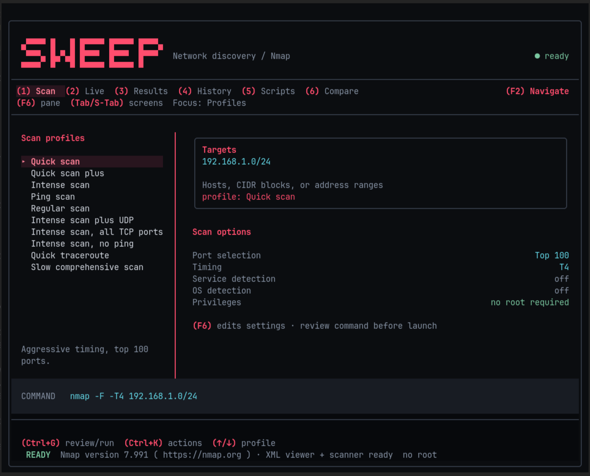

# Sweep

Terminal frontend for [Nmap](https://nmap.org). Build scans with Zenmap-style profiles and every major option group, watch live output, browse hosts/ports/scripts, and keep history on disk.



This wraps the real `nmap` binary. It does not reimplement scanning.

## Install

```sh
curl -fsSL https://raw.githubusercontent.com/design-nexus/sweep/main/install.sh | sh
```

That installs the `sweep` binary into `~/.cargo/bin`. The script installs a C compiler (`build-essential` / `gcc`) and a Rust toolchain if they are missing. You may be prompted for `sudo`.

From a clone (needs `cc`, e.g. `sudo apt-get install build-essential pkg-config`):

```sh
cargo install --path . --locked
```

Nmap itself (required to run scans; XML viewing works without it):

```sh
sudo apt install nmap    # Debian/Ubuntu
```

## Usage

```sh
sweep
sweep path/to/scan.xml
sweep -t scanme.nmap.org -p "Quick scan"
sweep -- nmap -sV scanme.nmap.org
```

Only scan networks you own or have permission to test.

## Keys

| Key | Action |
|---|---|
| `1`–`6` | Scan / Live / Results / History / Scripts / Compare |
| `Tab` / `Shift+Tab` | Next / previous screen |
| `F6` / `Shift+F6` | Next / previous pane |
| `F2` | Search screens and panes |
| `Ctrl-G` | Run (confirm) |
| `y` | Copy constructed command |
| `Ctrl-X` | Cancel nmap (SIGKILL after 3s) |
| `/` | Filter |
| `?` | Help |
| `q` | Quit |

Scan builder: `j`/`k` move, `space`/`enter` toggle or edit a field.

Results: `h`/`l` hosts, `j`/`k` ports, `[`/`]` detail pane, `o` show closed ports, `e`/`m`/`c` export JSON/Markdown/CSV.

## Root

SYN (`-sS`), UDP, OS detection, and `-A` need raw sockets. If you are not root, sweep tries `sudo -n nmap`. Run `sudo -v` first, or launch the TUI with sudo.

## Theme

Aurora is the default palette. `Ctrl+K` offers Aurora, Follow Omarchy, and Terminal themes. Use a terminal with 24-bit color (`kitty`, `wezterm`, `ghostty`, recent `alacritty`).

## Data

```
~/.local/share/nexus-map/history.toml
~/.local/share/nexus-map/scans/<timestamp>-<id>/{scan.xml,scan.nmap,scan.gnmap,meta.toml}
```

## Profiles

Zenmap defaults: Intense scan, Intense plus UDP, all TCP ports, no ping, Ping scan, Quick scan, Quick scan plus, Quick traceroute, Regular scan, Slow comprehensive scan.

## Interface and themes

New installations use Crimson: near-black surfaces, crimson focus and shortcuts, steel-gray text, cyan data, and distinct status colors. Aurora remains available through Ctrl+K actions. Existing explicit theme choices and legacy config/data locations are retained. `Ctrl+K` searches actions; Esc closes the palette. Actions use the same confirmations as their keyboard shortcuts. Tab / Shift+Tab changes screens; F6 / Shift+F6 changes panes. F2 opens Navigation. Details scroll with Page Up / Page Down. Narrow layouts show the active pane; the minimum terminal is 30×14.

Build requirements: Rust 1.88 or newer, Ratatui 0.30.2, Crossterm 0.29. Run `cargo test --locked` before `./install.sh`. The command is `sweep`; no compatibility command aliases are installed.

See [shared navigation](docs/navigation.md) for keyboard and mouse controls.

Screenshots show actual Foot renders with sample data. The security tools default to Crimson; select **Aurora theme** in Ctrl+K actions to restore the previous palette.

See [Crimson theme](docs/themes.md) for selection and verification details.
